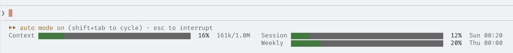
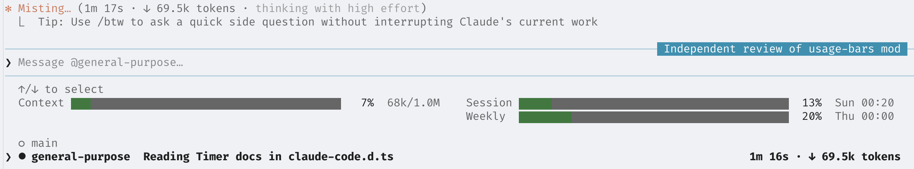
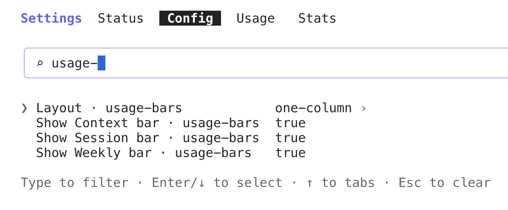

# usage-bars

A Claude Code mod that shows your plan's usage limits and the current context fill as progress bars under the prompt, right below the mode line.



While you view a subagent's transcript, the Context bar shows that subagent's context:



- **Context:** how full the context window is, as tokens used out of the window size.
- **Session:** the 5-hour usage window, with its reset time.
- **Weekly:** the 7-day usage window, with its reset day and time.
- The bars fill green, turn yellow at 70% and red at 90%, and use your theme's colours in light and dark mode.
- The bars stretch with the width of the prompt's column, including when a pane is docked beside the transcript. Every other part has a fixed width, so the bars stay aligned.
- On a narrow terminal (under about 71 columns) the bars stack in a single column, and below about 36 the reset and token figures are dropped.
- The layout and which bars show can be changed: see [Options](#options).

## Install

At the prompt of a Claude Code terminal session:

```
/plugin install usage-bars --marketplace nazariitaran/claude-code-usage-bars
```

Answer `y` to add the marketplace, then pick the user scope.

From a shell:

```
claude plugin install usage-bars --marketplace nazariitaran/claude-code-usage-bars
```

In the desktop app, click **+** next to the prompt box, then **Plugins**. Choose **Add marketplace**, enter `nazariitaran/claude-code-usage-bars`, then choose **Add plugin**.

## Options

Set them when you install, or later in `/config`: type `usage-bars` to filter the list. A change applies straight away.



| Option | Values | Default |
| --- | --- | --- |
| Layout | `one-column`: every bar stacked<br>`two-columns`: Context on the left, the limits on the right<br>`three-columns`: each bar in its own column | `two-columns` |
| Show Context bar | `true` / `false` | `true` |
| Show Session bar | `true` / `false` | `true` |
| Show Weekly bar | `true` / `false` | `true` |

- The layout sets the most columns. A terminal too narrow for them gets fewer: three columns need about 106, two need about 71.
- Hidden bars leave no gap. With Context hidden, two columns put Session and Weekly side by side, and three columns with one bar hidden draw two.
- A gateway's Spend bar has no toggle. It follows the limits, on the next row in three columns.

## Notes

- **Subscription only:** the usage limits come with a Pro or Max subscription. With an API key, only the context bar is shown.
- **When the bars update:** the figures come from the API's responses. The context bars update after every API call, including those within a long turn. The usage limits update when Claude Code reports a change, at the latest when the turn ends. Usage from your other sessions shows up after this session's next response.
- **New, cleared and resumed sessions:** the usage limits start from the last figures any session saw, until the first reply brings fresh ones. The Context bar is drawn empty, with `–`, until then.
- **Resets:** once a window's reset time passes, its bar drops to 0% without waiting for the next response.
- **Subagents:** a subagent's bar shows the input tokens of its latest API call, and 0% until it has made one. Claude Code only reports the window size for the main conversation, so a subagent on the same model is measured against that size and one on any other model against 200k. If the main conversation uses a 1M window and the subagent the standard one, its bar reads low.
- **Viewed transcript:** the mod learns which transcript you're viewing from the band above the prompt. If another plugin draws that band without passing it on, the Context bar keeps showing the main conversation.

## Development

```
claude --plugin-dir .            # run a session with the mod loaded from this folder
claude plugin validate .         # check the manifest and hooks module
claude plugin test .             # run tests/*.test.tsx
```

- `hooks/register.tsx`: the hooks module.
- `types/index.d.ts`: the state contract.

When Claude Code loads the mod, it writes the API types to `.claude-plugin/types/`. After that, `tsc -p .` type-checks the mod.

## License

MIT
